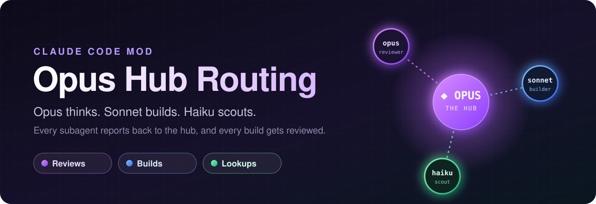
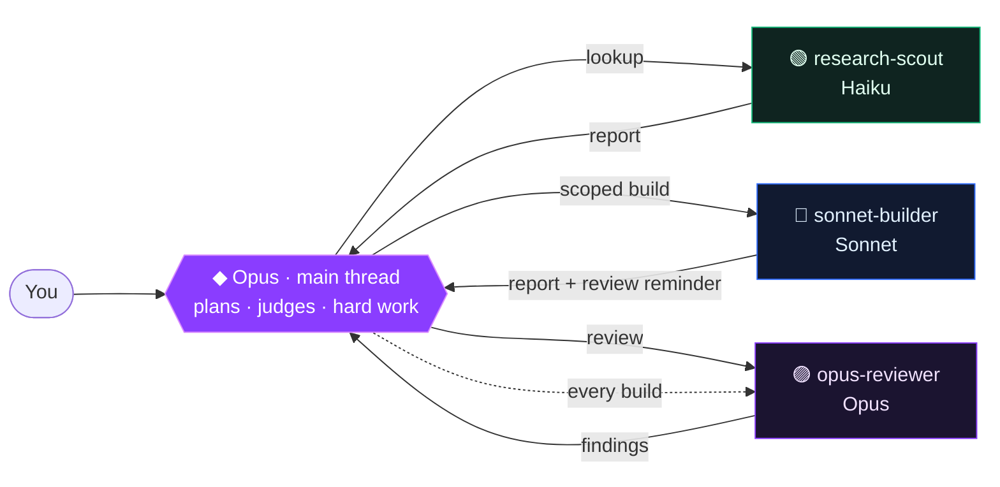
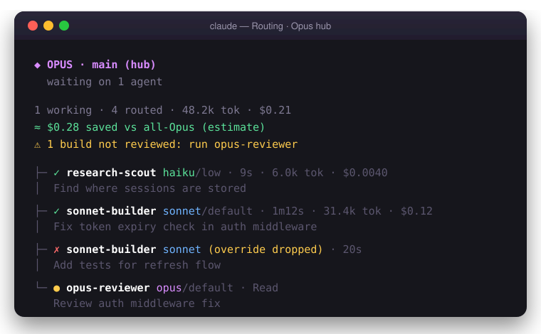

<div align="center">



<br/>

**Keep Opus in charge. Send only clear-cut work to cheaper models. Watch all of it live.**

<br/>

<a href="#-install"></a>
<a href="https://docs.claude.com/en/docs/claude-code"></a>

<a href="LICENSE"></a>

<br/><br/>

<a href="#-install">Install</a> &nbsp;·&nbsp;
<a href="#-how-it-works">How it works</a> &nbsp;·&nbsp;
<a href="#-the-routing-pane">The pane</a> &nbsp;·&nbsp;
<a href="#-guardrails">Guardrails</a> &nbsp;·&nbsp;
<a href="#-savings-math">Savings math</a> &nbsp;·&nbsp;
<a href="#-faq">FAQ</a>

</div>

<br/>

## ✨ Why

Sonnet and Haiku handle clear-cut jobs about as well as Opus, for a fraction of the cost. On hard work they lose quality, and every hand-off loses a little detail. So the safe split is:

> [!TIP]
> **Opus stays the hub.** It plans, judges and does the hard parts itself. Cheaper models get only bounded jobs, and their work always comes back to Opus for review.

<table>
<tr>
<td width="33%" valign="top">

### 🟣 `opus-reviewer`
**Model:** Opus

Reviews, audits, security checks, verifying finished work. Read-only. Reports findings ranked by severity with `file:line` and a fix.

</td>
<td width="33%" valign="top">

### 🔵 `sonnet-builder`
**Model:** Sonnet

Scoped changes once the plan is clear: a known bug, tests, a pattern refactor. Runs the build or tests and reports the real result.

</td>
<td width="33%" valign="top">

### 🟢 `research-scout`
**Model:** Haiku

Finding files and symbols, codebase search, web search, fetching docs. Read-only and cheap. Returns conclusions with sources.

</td>
</tr>
</table>

**Everything else** (unknown-cause bugs, multi-file design, architecture research) stays on Opus in the main thread.

<br/>

## 🚀 Install

At the prompt of a Claude Code terminal session:

```
/plugin install opus-hub-routing --marketplace kuldeep-jadeja/opus-hub-routing
```

Answer `y` to add the marketplace, then press Enter to pick the user scope. That's it: the agents, the routing rule and the pane are all active right away.

<details>
<summary><b>Other ways to install</b></summary>

<br/>

**From a shell:**

```bash
claude plugin install opus-hub-routing --marketplace kuldeep-jadeja/opus-hub-routing
```

**In the desktop app** (where `/plugin` does not run): click **+** next to the prompt box, then **Plugins**, **Add marketplace** with `kuldeep-jadeja/opus-hub-routing`, then **Add plugin**.

</details>

<details>
<summary><b>Uninstall</b></summary>

<br/>

```
/plugin uninstall opus-hub-routing
```

Nothing is written to your `CLAUDE.md` or `~/.claude/agents`, so removing the plugin removes everything.

</details>

<br/>

## 🧭 How it works



One install adds three things:

| Part | What it does |
| :-- | :-- |
| **Agents** | `opus-hub-routing:opus-reviewer`, `:sonnet-builder` and `:research-scout`, each pinned to its model. |
| **Routing rule** | Added to the conversation's first message, so Claude knows which agent fits which job. You don't need to edit `CLAUDE.md`. |
| **Routing pane** | A live side pane showing the hub, every subagent, its model, status, tokens and cost. |

<br/>

## 📟 The routing pane

<div align="center">

</div>

<br/>

- **Hub line:** which model the main thread runs on and what it's doing. If it isn't Opus, it tells you right away to run `/model opus`.
- **Summary:** how many agents are working, how many were routed, total tokens and cost.
- **Savings:** roughly how much cheaper this was than running every subagent on Opus.
- **Review warning:** any Sonnet build that no Opus review has checked yet.
- **One row per subagent:** ✓ done · ● running (with its current tool) · ✗ failed, plus time, tokens and cost.

Type **`/routing`** to reopen the pane and print a summary of the session.

> [!NOTE]
> The pane opens on its own when the terminal is wide enough. In a narrower window, `/routing` opens it.

<br/>

## 🛡️ Guardrails

The rule isn't only written down. The mod also enforces it:

| Guardrail | What happens |
| :-- | :-- |
| **Model overrides dropped** | If Claude passes a `model` to one of the three agents, the mod removes it so the agent's own model wins. A toast tells you, and the row shows *(override dropped)*. |
| **Builds get reviewed** | Every `sonnet-builder` report reaches Opus with a reminder to run `opus-reviewer`. The pane keeps a warning up until a review finishes. |
| **Hub check** | The pane flags it as soon as the main thread isn't on Opus, even before anything is delegated. |
| **Fails open** | If a hook in the mod ever fails, your work goes on as if the mod weren't there. It never blocks a tool call. |
| **Clean slate on `/clear`** | The routing record starts over with the new conversation. |

<br/>

## 💸 Savings math

Costs come from Claude Code's own `/cost` ledger for each subagent. The savings line compares that with what the same tokens would cost on Opus, at current list prices:

| Model | Input / 1M tokens | Output / 1M tokens | Opus costs |
| :-- | --: | --: | --: |
| 🟣 Opus 5.5 | $4.00 | $20.00 | 1× |
| 🔵 Sonnet 5.5 | $2.00 | $10.00 | **2×** more |
| 🟢 Haiku 5.5 | $0.10 | $0.50 | **40×** more |

> [!IMPORTANT]
> Every dollar figure is an **estimate**, not your bill. On a subscription plan it shows usage, not money you were charged.

<br/>

## ❓ FAQ

<details>
<summary><b>I already copied these agents into <code>~/.claude/agents</code> by hand. Do they clash?</b></summary>

<br/>

No. The plugin's agents have the `opus-hub-routing:` prefix, and the pane recognizes both the prefixed and the plain names. Once the plugin is installed you can delete your hand-copied files and any routing section in `CLAUDE.md`, so Claude reads only one version of the rule.

</details>

<details>
<summary><b>Will this make Claude delegate more?</b></summary>

<br/>

No. The rule tells Claude to judge difficulty, not keywords, and to keep hard work on the main thread. It only steers *which* agent gets a job that's worth delegating.

</details>

<details>
<summary><b>Does it send anything anywhere?</b></summary>

<br/>

No. The mod reads Claude Code's own session data and draws the pane. It makes no network calls and no model calls of its own.

</details>

<details>
<summary><b>Can I change an agent's model or prompt?</b></summary>

<br/>

Fork the repo, edit the file in `agents/`, and install from your fork. Keep the file name the same so the pane and the guardrails still recognize the role.

</details>

<br/>

## 🧪 Development

```
.
├── .claude-plugin/
│   ├── plugin.json        # manifest
│   └── marketplace.json   # makes the repo installable in one line
├── agents/                # opus-reviewer · sonnet-builder · research-scout
├── hooks/
│   ├── hooks.json
│   └── register.tsx       # routing rule, guardrails, pane
├── types/index.d.ts       # state contract
├── tests/pane.test.tsx    # 9 tests
└── assets/                # banner, pane preview, icon
```

```bash
claude plugin validate .   # checks the manifest, agents and hooks
claude plugin test .       # runs the tests
claude --plugin-dir .      # runs a session with your local copy
```

<br/>

<div align="center">

**MIT licensed** · Made for people who want Opus quality without paying Opus prices for every lookup.

<sub>If this saved you tokens, a ⭐ helps others find it.</sub>

</div>
